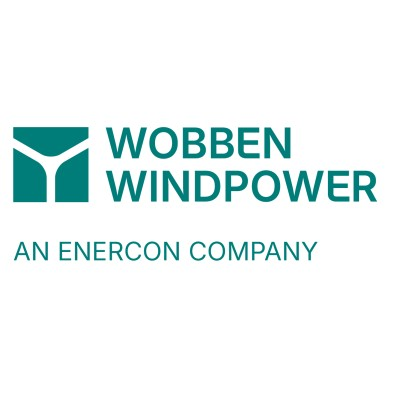

### Olá, meu nome é João Vitor Neves! 👋

Trabalhando na Wobben Windpower (ENERCON)  Atuando como estagiário de TI prestando suporte a sistemas SAP

## Minhas Skills

**Linguagens**

**Dados, automação e sistemas**

**Ferramentas**

## Experiência de trabalho

**Estagiário de TI** \
[**Wobben Windpower (ENERCON)**](https://www.wobben.com/) • Estágio \
Linguagens & Tecnologias: `Python`, `Power BI`, `Power Query`, `Power Automate`, `SAP`, `ServiceNow`, `Excel`, `Active Directory` \

**Principais atividades:**
- Suporte a sistemas corporativos via ServiceNow, com acompanhamento de SLA, e gestão de acessos e perfis de usuários no SAP.
- Desenvolvimento de dashboards em Power BI para acompanhamento de chamados e usuários ativos.
- Extração e tratamento de dados com Excel e Power Query, e desenvolvimento de automações com Python e Power Automate.

## Onde me encontrar

